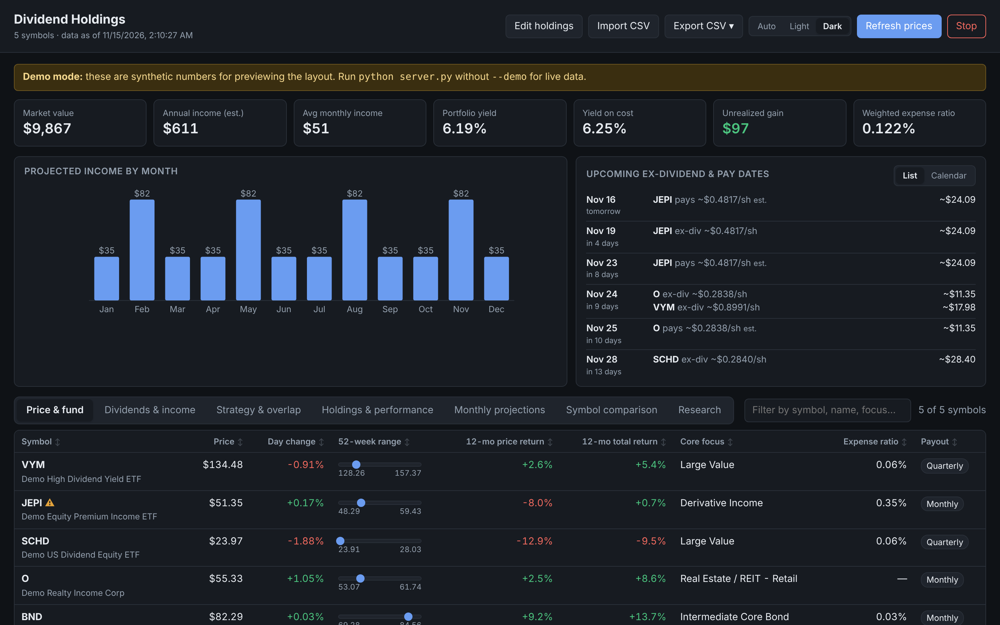
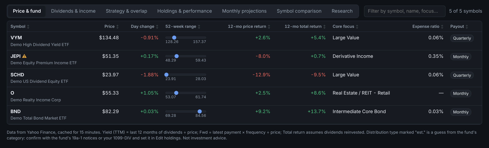
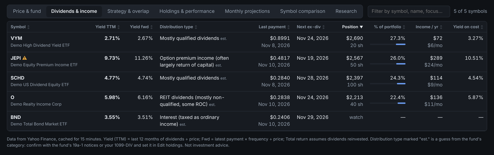
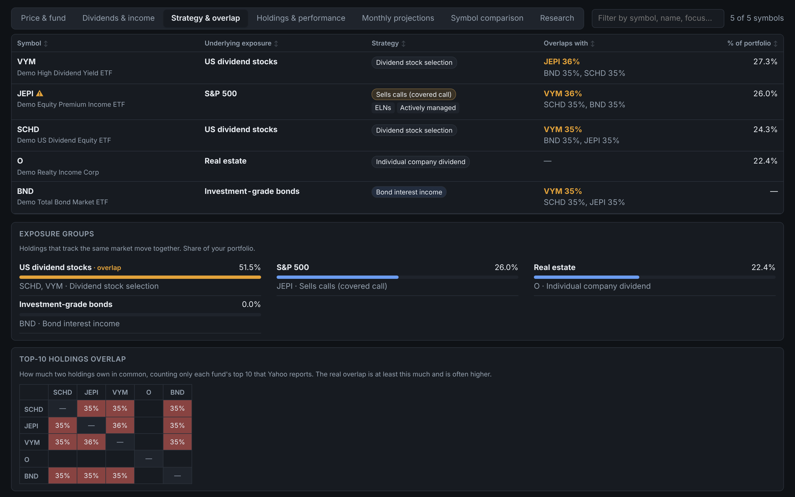
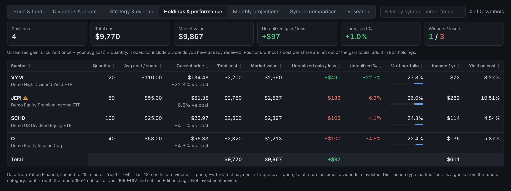
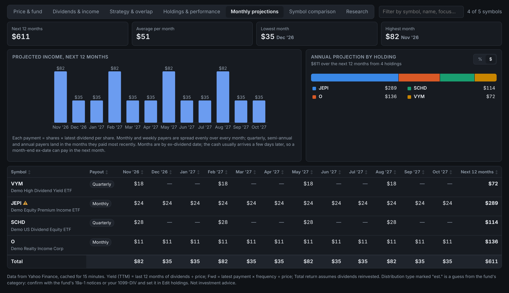
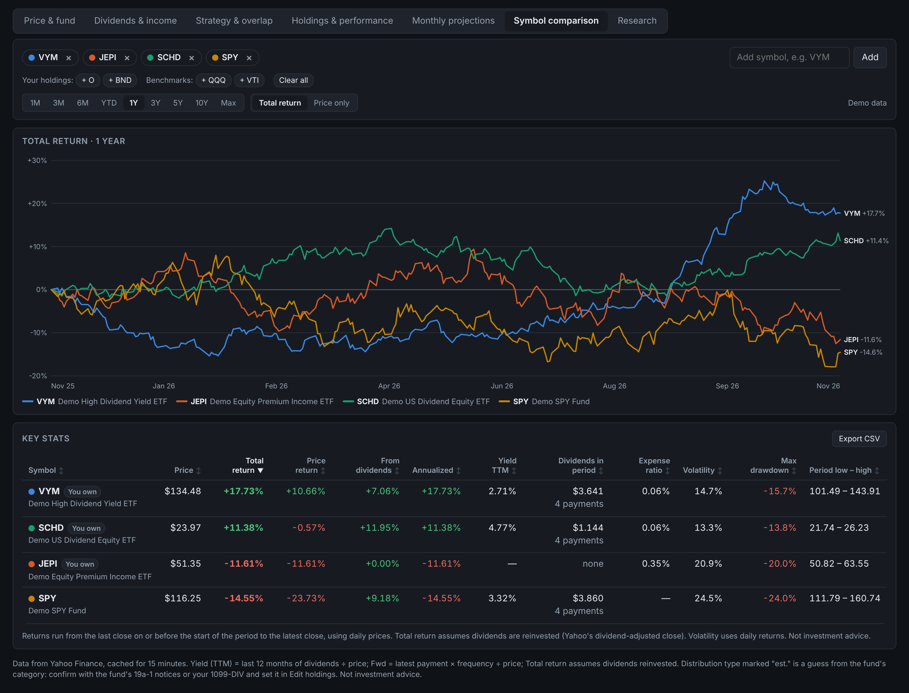
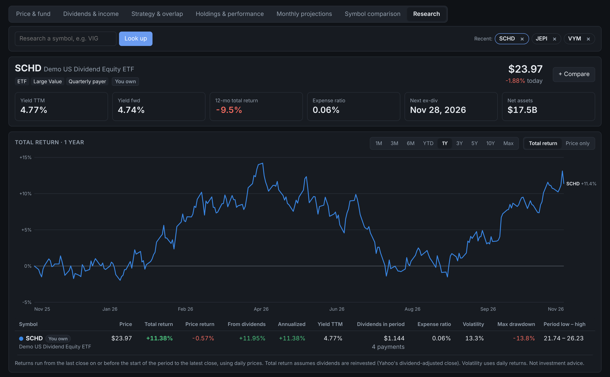

# Dividend Holdings Dashboard

A small local dashboard for your dividend ETFs, funds and stocks. It runs on your
own computer, uses free Yahoo Finance data, and needs no API key, account, or
extra Python packages (only the standard library, so Windows Smart App Control
has no third-party DLLs to block).

New here? Start with [GETTING_STARTED.md](GETTING_STARTED.md), a short step-by-step guide.



## Screenshots

All screenshots use the built-in demo data (`python server.py --demo`), so the holdings and
dollar amounts are synthetic. Click a tab name to see it.

<details>
<summary><strong>Price & fund</strong></summary>



</details>

<details>
<summary><strong>Dividends & income</strong></summary>



</details>

<details>
<summary><strong>Strategy & overlap</strong></summary>



</details>

<details>
<summary><strong>Holdings & performance</strong></summary>



</details>

<details>
<summary><strong>Monthly projections</strong></summary>



</details>

<details>
<summary><strong>Symbol comparison</strong></summary>



</details>

<details>
<summary><strong>Research</strong></summary>



</details>

## Start it

You need Python 3.9 or newer (python.org).

- **Windows:** double-click `run_windows.bat`
- **Mac / Linux:** run `./run_mac_linux.sh` in a terminal

Or by hand, from a command prompt in this folder:

```
python server.py
```

Your browser opens at http://127.0.0.1:8765.

## Stop it

- **Stop button:** click **Stop** at the top right of the dashboard and confirm. The server
  shuts down and its command window closes by itself.
- **Windows:** double-click `stop_windows.bat`.
- **Mac / Linux:** run `./stop_mac_linux.sh`.
- Or press Ctrl+C in the command window.

If you started it with `--port`, pass the same port to the stop script, e.g. `stop_windows.bat 9000`.
A web page can't run a `.bat` file, so the Stop button asks the server to shut itself down instead.
It only accepts that request from this computer. If the server ends with an error, the window
stays open so you can read the message.

To preview the layout without internet, run `python server.py --demo` (synthetic numbers).

## Your holdings

Click **Edit holdings** in the page, use **Import CSV**, or edit `holdings.csv` in Excel
(close it in Excel before saving from the page). On first run, `holdings.csv` is
created from `holdings.example.csv`.

| column | meaning |
|---|---|
| symbol | ticker, e.g. SCHD |
| shares | leave blank to track as a watchlist item |
| cost_basis | your average cost per share (for yield on cost and gain) |
| frequency | optional override: Weekly, Monthly, Quarterly, Semi-annual or Annual (blank = detect automatically) |
| distribution_type | optional override, e.g. "Qualified", "Return of capital" |
| flagged | `yes` to highlight the symbol everywhere in the dashboard (e.g. you're not currently adding to it, or watching it cautiously); blank = not flagged |
| notes | anything you like |

## Flagging holdings to watch

Tick **Flag** in Edit holdings for anything you're not currently adding to or are
cautiously watching. Its symbol is then highlighted in amber everywhere it appears:
the main table (with a "Flagged" tag and an amber bar on the left), the ex-dividend
list and calendar, the overlap panels, and the detail view. The **All / Flagged /
Not flagged** switch next to the filter box shows all holdings, just the flagged
ones, or just the rest. Typing "flagged" in the filter works too. The flag is saved in the `flagged` column of holdings.csv, so it travels
with your file to your other computer (Export/Import and shared cloud folder both
carry it). Files without that column still load as before, with nothing flagged.
If one computer still runs an older version of the dashboard, saving from it would
drop the flags, so update both.

## Using it on more than one computer

There are two ways to keep a desktop and a laptop in step.

**Option 1: one shared file in a cloud folder (set once, then automatic).**
Move your `holdings.csv` into a folder that OneDrive, Dropbox, iCloud Drive or
Google Drive syncs, then create a file called `holdings_path.txt` next to
`server.py` on each computer, containing the full path of that file or folder:

```
C:\Users\YourName\OneDrive\Dividends\holdings.csv
```

(on a Mac, something like `/Users/yourname/Library/Mobile Documents/com~apple~CloudDocs/Dividends`).
Both computers then read and save the same file, so a change on one shows up on
the other after the cloud app syncs. If the folder is empty the first time, the
local `holdings.csv` is copied into it. If the folder can't be found, the
dashboard says so in the terminal and falls back to the local file. You can also
use `python server.py --holdings PATH` or the `DIVIDEND_HOLDINGS` environment
variable instead of `holdings_path.txt`. Edit holdings shows which file is in use.
Avoid having the dashboard open and saving on both computers at the same moment.

**Option 2: Export and Import (no setup).**
1. On the computer with the latest holdings: **Export CSV → Holdings file**. It
   downloads `holdings-YYYY-MM-DD.csv` with shares, cost and all your overrides
   (frequency, core focus, distribution type, strategy, exposure, flag, notes).
2. Get that file to the other computer (email, USB stick, cloud folder).
3. There: **Import CSV**, pick the file, check the preview, and click Import.

The preview lists each symbol as new, changed (old → new value), removed, or
unchanged, and lets you choose:
- **Replace**: your holdings become exactly what's in the file. Use this for
  desktop → laptop copies.
- **Merge**: symbols in the file are added or updated; everything else is kept.

Before an import saves, the current file is copied to `backups/` next to it
(the newest 20 are kept), so you can undo by copying a backup back over
`holdings.csv`. Rows with an invalid number are skipped and listed in the
preview. Import also accepts the **Dashboard table** export (only symbols, shares
and cost are taken from it) and simple broker files with columns like
`Symbol/Ticker`, `Shares/Quantity` and `Cost basis` or `Total cost`; other columns are ignored.

**Updating the dashboard itself:** the zip ships `holdings.example.csv`, not a
`holdings.csv`, so unzipping a new version over your folder never overwrites
your holdings.

## What it shows

Main table (click a column to sort, click a row for details):
symbol and name, current price and day change, 52-week range with a marker for
where the price sits, core focus (fund category, or sector/industry for stocks; when it is blank
or wrong, type your own in Edit holdings, column `core_focus` in holdings.csv),
payout frequency (inferred from the payment history), expense ratio, current
yield (trailing 12 months and forward), 12-month price return and total return
(dividends reinvested), distribution type, top holdings, next ex-dividend date, and your position size and income.

Extras:
- Light / dark theme: the Auto / Light / Dark switch in the header. Auto follows
  your computer's setting; your choice is remembered in that browser.
- Portfolio tiles: market value, annual and monthly income, portfolio yield,
  yield on cost, unrealized gain, weighted expense ratio, next ex-dividend.
- Projected income by month and an upcoming ex-dividend & pay date calendar.
  Click any day with dates on it to see every symbol for that day, with amounts.
- Detail view per symbol: 1-year price chart, dividends per share by year, dividend growth (1 year and
  5-year CAGR), years
  of consecutive increases, payout variability, recent payments, full top 10
  holdings, sector and asset-class mix, fund description, 3y/5y annualized total return (worked out from monthly
  prices, so it shows for stocks too), beta, AUM.
- Warning flags: very high yield, recent dividend cut, price falling while yield
  is high (possible NAV decay), expense ratio over 0.75%, erratic payouts.
- Strategy & overlap tab: each holding's underlying exposure (Nasdaq-100,
  S&P 500, etc.) and options strategy (selling calls, selling puts, ELNs,
  partial overwrite, index options), overlap between holdings based on their
  top 10 holdings, exposure groups, a look-through of your biggest underlying
  stocks across all funds, and a plain-English glossary of the strategies.
  Strategy and exposure are estimated from the fund's name first, then its
  description and category; for single stocks and closed-end funds the exposure is
  the sector (or "Closed-end fund / BDC"). You can override
  them in Edit holdings (columns `strategy` and `exposure` in holdings.csv).
- Holdings & performance tab: quantity, average cost per share, current price,
  total cost, market value, unrealized gain/loss ($ and %), portfolio weight,
  income and yield on cost, with totals. Above the table, **Holdings by size** shows every
  position by market value, largest first, as a stacked bar (top 19 plus Others) and a
  ranked list with each one's $ and % of the portfolio (switch between $, % or Both); hover to highlight, click a symbol
  for its details.
- Monthly projections tab: projected income for each holding over the next 12
  months, with monthly totals and a chart. Monthly and weekly payers count in
  every month; quarterly, semi-annual and annual payers repeat the month of their
  latest payment. Months are by ex-dividend date.
  Beside the chart, **Annual projection by holding** splits the next 12 months'
  income into a stacked bar and a two-column list (top 19 holdings plus Others),
  shown in $ or % of the total. It follows the flagged / not flagged filter and the
  search box; hover to highlight, click a symbol for its details.
- Symbol comparison tab: compare up to 10 tickers side by side, any symbol (not
  just your holdings), over 1M, 3M, 6M, YTD, 1Y, 3Y, 5Y, 10Y or Max. Type a ticker
  (or several, separated by commas) in the box, or click one of your holdings or a
  benchmark (SPY, QQQ, VTI, SCHD) to add it; × removes it. The chart shows each
  symbol's % change from the start of the period, as **Total return** (dividends
  reinvested) or **Price only**; hover over it to read every symbol on one date. Each symbol gets its own
  color; the 9th is white in dark mode (charcoal in light mode) and the 10th is teal.
  The Key stats table (click a column to sort) has price, total and price return,
  the part that came from dividends, annualized return (periods of a year or more),
  trailing-12-month yield, dividends paid in the period, expense ratio (for symbols
  in your holdings), volatility, max drawdown and the period's low and high. Rows
  for symbols you hold open the detail view. **Export CSV** on that card saves the
  stats. Your symbols and period are remembered in that browser; the first time,
  it starts with your three largest holdings plus SPY. If a fund is newer than the
  period, its returns start from its first price and the table says so. Prices are
  daily up to 3Y, weekly for 5Y and 10Y, monthly for Max. Use Yahoo's ticker
  format, e.g. `BRK-B`, or `^GSPC` for the S&P 500 index.
- Research tab: look up any one symbol, held or not. Type a ticker and click
  **Look up**. It shows the price, today's change and headline numbers (yield,
  12-month total return, expense ratio, next ex-dividend, size); the same 1M to Max
  chart and Key stats as Symbol comparison (just for that symbol); and everything in
  the holding detail view: price and fund facts, dividends (frequency, yields,
  growth, streak, payout variability, distribution type, strategy, exposure),
  dividends per share by year, top holdings, sectors, asset classes, description
  and recent payments. Your position is included if you hold it. **+ Compare** adds
  the symbol to the Symbol comparison tab. The last 10 symbols you looked up are
  listed under Recent, and the period you picked is remembered in that browser.
- Planning tab: try what-if allocations without touching your holdings. A plan has one or
  more accounts (a new plan starts with Taxable brokerage, Traditional IRA and Roth IRA; rename,
  add or remove them), each with a balance and a list of symbols. Add symbols by typing them
  (any ticker, held or not, several at once separated by commas) or with one click from **Your
  holdings** (**+ All** adds every one). For each symbol you set a weight % or a dollar amount,
  and the row shows distribution type, payout frequency, yield, expense ratio, income per year
  and per month, and what you hold in it now. Each account checks that its weights add up to
  100%; **Spread evenly** splits it equally. To pin an exact dollar amount, type it in the row's
  Amount box and click its lock (🔒): the amount stays put when the balance changes, and the button
  becomes **Spread rest over unlocked**, which splits what the locked rows leave of the balance
  equally over the unlocked ones. Locks are saved with the scenario. Yield is forward or TTM (switch at the top), or type
  your own in the row. Expense ratio is shown for reference only: fund yields are already paid
  after fees, so it is not subtracted again. At the top: total invested, annual and monthly
  income, blended yield, weighted expense ratio and the difference from your portfolio now,
  plus income by month (plan vs. now), by distribution type and by account.
  **Start from my holdings** loads what you own at today's weights, so you can try a rebalance.
  **Save** keeps the plan as a named scenario in `<holdings file name>-plans.json` next to your
  holdings file (so it syncs with it); **Save as new** makes a copy, and the **Saved scenarios**
  table lists them all against your portfolio now. Click one to open it.
- Summary tab: a one-page snapshot of the whole portfolio to print or share. It shows metric
  cards (portfolio value, annual and monthly income, current yield, yield on cost, total gain / loss,
  holdings), the next 12 months of projected income with the annual total, income by payout
  frequency (weekly, monthly, quarterly and so on), allocation donuts by holding and by Core focus, Holdings by size (with the $ / % / Both
  switch), Annual projection by holding (with its % / $ switch) and your flagged holdings. The date
  is stamped at the top. **Save as PNG** saves it as one image and **Download PDF** as a letter-size
  PDF, both in the theme you are using, made in the browser with no add-ons and no internet needed.
  **Hide $ amounts** swaps every dollar figure for $••• (percentages stay) so you can post it
  without showing your balances; the exports follow it too.
- Export CSV (the dashboard table for Excel; Filtered holdings, which is the same
  table but only the rows currently shown after your filter text, All / Flagged /
  Not flagged and tab, in the table's sort order; or your holdings file) and Import CSV
  (see "Using it on more than one computer").

## Notes and limits

- Data is cached for 15 minutes in `.cache.json`; **Refresh prices** forces a new pull.
  If Yahoo is unreachable it falls back to the last cached data.
- Yahoo does not publish the tax character of distributions. "Distribution type"
  marked *est.* is a guess from the fund's category (e.g. covered-call funds are
  often return of capital, bond funds pay interest). Check the fund's 19a-1
  notices or your 1099-DIV, then set it in Edit holdings.
- The next ex-dividend date is Yahoo's announced date when available, otherwise
  estimated from the payment cadence (*est.*).
- Yahoo announces at most one pay date per holding (often none for ETFs), so the
  calendar estimates every other pay date as ex-date + that holding's usual gap
  (dashed green chips). The gap comes from Yahoo's latest ex/pay pair when it has
  one, is remembered in `.cache.json` for later, and otherwise defaults to a typical
  gap: about 4 days for funds, 1 day for weekly payers, 2 to 3 weeks for stocks.
- Yahoo's data feed is unofficial and can change. If the built-in client stops
  working, `python server.py --yfinance` uses the yfinance library instead
  (needs `pip install yfinance`; on Windows with Smart App Control, its pandas
  DLLs may be blocked).
- This is for information only, not investment advice.

## License

MIT. See [LICENSE](LICENSE). The license covers this code only; market data comes from Yahoo Finance under Yahoo's own terms.
